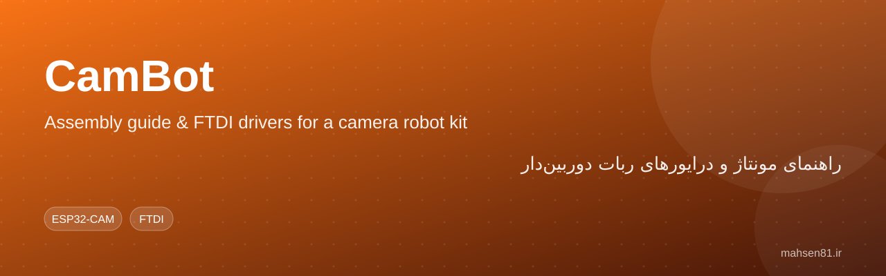
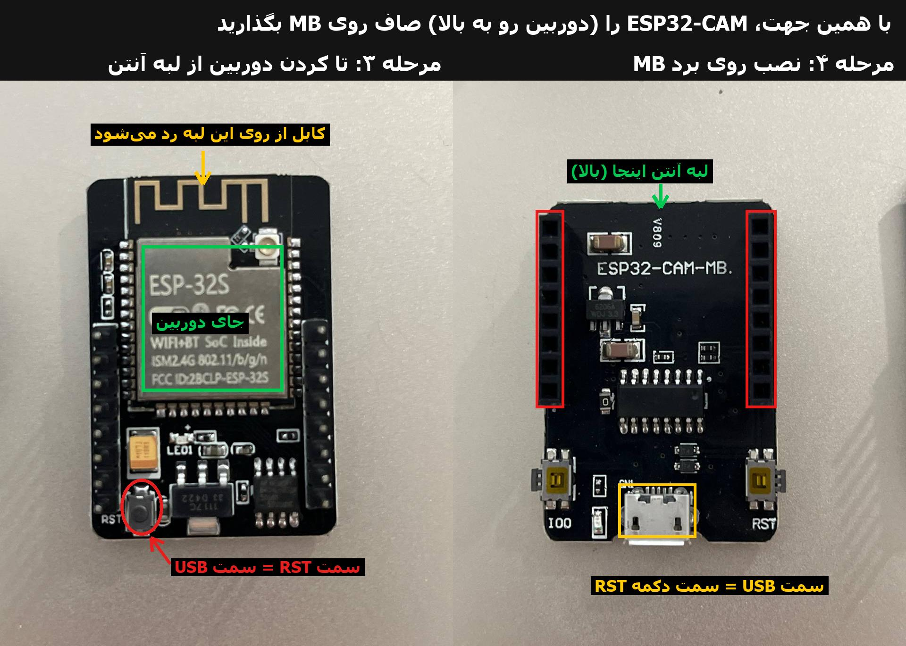
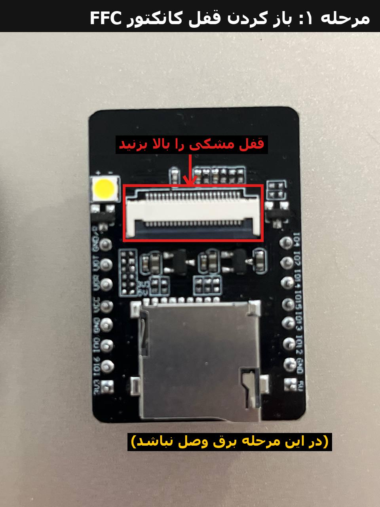
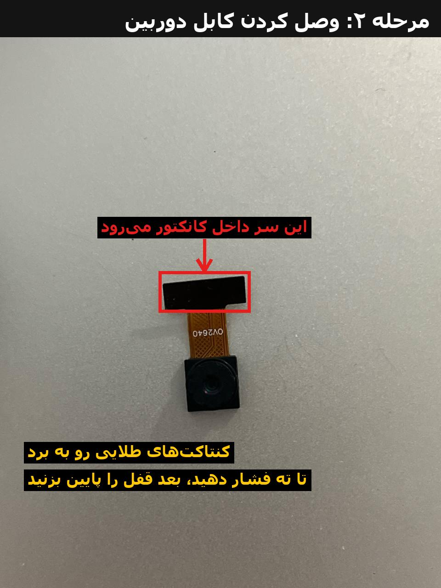
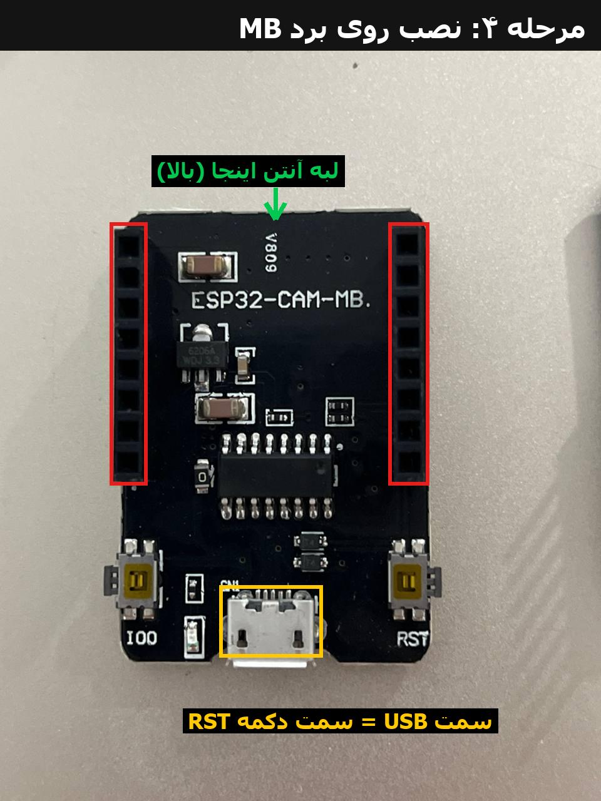

<!-- gen:header -->
<p align="center"></p>

<h1 align="center">CamBot</h1>
<p align="center"><b>راهنمای مونتاژ و درایورهای ربات دوربین‌دار</b><br><i>Assembly guide & FTDI drivers for a camera robot kit</i></p>
<p align="center"> </p>

<div dir="rtl">

## ✨ امکانات

- راهنمای تصویری مونتاژ مرحله‌به‌مرحله
- درایور FTDI برای پروگرام کردن

</div>

## 📸 تصاویر · Screenshots

<p align="center">    </p>

## 🚀 Quick start

```bash
See assembly/ images in order; install ftdi_driver/ before flashing.
```

---

<p align="center">ساخته‌شده توسط <a href="https://mahsen81.ir"><b>محسن جباره‌اصل</b></a> — برنامه‌نویسی، طراحی سایت، ربات و هوش مصنوعی<br>
Built by <a href="https://mahsen81.ir">Mohsen Jabbareh-Asl</a> · ⭐ اگر مفید بود، ستاره بدهید · Need a custom version? <a href="https://mahsen81.ir">Get in touch</a></p>
